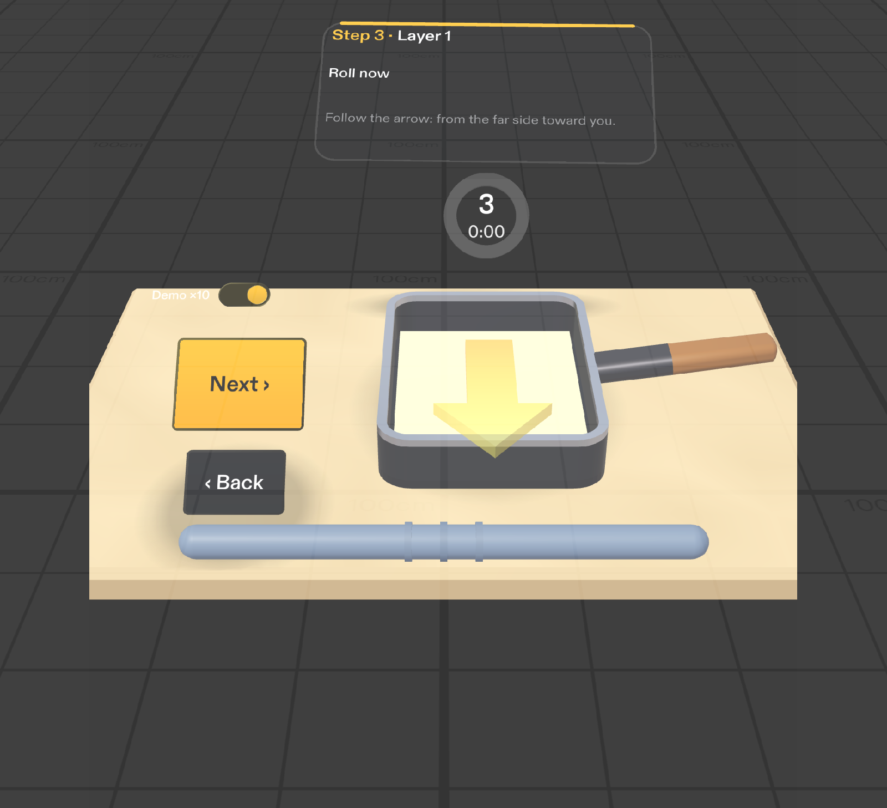

# Tamago Coach

A SPECS (Snap Spectacles) Lens that coaches a beginner through tamagoyaki, the Japanese rolled omelette, hands-free. The cue lives on the pan, not on a screen: the egg shows you when it is ready, an arrow on the pan shows which way to roll, and the roll grows as you go.

Built for the Devpost **Learn AR with SPECS** hackathon. Demo video: https://youtu.be/K7lrDOghO_E (2:43, recorded in the Lens Studio preview).

More views in [`devpost/screenshots/`](devpost/screenshots/): the Prep layout, a countdown with the card collapsed, and the six slices at Done.

## What it does

- A virtual counter with a real-size tamagoyaki pan appears in front of you. Grab the bar on its near edge to move the whole set onto your own stove.
- Six steps: Prep, Heat (1:00), Layer 1 to 3 (0:30 each), Rest & slice (2:00). Timed steps count down on a ring at the far rim of the pan.
- When a layer's countdown reaches zero: a chime, the card expands with "Roll now", and an arrow sweeps across the egg from the far side toward you. Pinch Next after you roll. The rolled log at the far side of the pan grows each layer, and the egg surface turns from glossy to matte as it sets, so the timer teaches what to look for in a real pan.
- The card says less each layer, because by the third layer you know the rhythm.
- Pinch only: Next and Back buttons on the counter, pinch the ring to pause, and a Demo ×10 switch for demos and tests. No voice, no custom gestures.

## Run it in Lens Studio

1. Install Lens Studio 5.24 (Windows 11 or macOS 12+) and open `TamagoCoach.esproj`.
2. In the Preview panel pick a SPECS device in Interactive mode. WASD moves, Q and E go down and up, right-drag looks around, and a click acts as a pinch.
3. Pinch the Demo ×10 switch at the far-left corner of the counter to run every timer ten times faster.

No SPECS glasses are needed.

## Tests (LEAF)

`Assets/LeafTests/` holds seven LEAF scenarios: one for each done criterion in the design brief, an IK reachability check for the Next button, and a regression test for the Demo switch. Run them from the LEAF panel in Lens Studio. All seven pass.

Three more scenarios (`DemoTour`, `DemoGrab`, `DemoCamera`) have no assertions: they drive the Lens for the demo video, which was captured from the Lens Studio preview.

## How it was built

- Planned with the Devpost Learn skill pack. `plan-lens` interviewed the author and wrote [`devpost/design-brief.md`](devpost/design-brief.md).
- Built by Claude Code through Snap's CLAD plugin (`ls-clad`) and the Lens Studio MCP. The agent authored the scene, the TypeScript components, the primitive meshes (counter, pan, egg, arrow, ring: all generated in code, no 3D models), the chime, and the UI Kit panels, then checked screenshots from the user's viewpoint.
- Tested with LEAF. The tests found one real bug (the Demo switch callback) and one reach problem (Next and Back sat 83 cm from the head), both fixed with design notes rather than hand-written code.
- Build report: [`devpost/build-report.en.md`](devpost/build-report.en.md) (English summary) and [`devpost/build-report.md`](devpost/build-report.md) (full, in Chinese).

## Structure

- `Assets/Scripts/` TypeScript components (main flow, egg, ring, card, controls, grab bar, placement, billboard, meshes)
- `Assets/LeafTests/` LEAF scenarios
- `Assets/GeneratedSFX/` the chime
- `devpost/` planning docs from the skill pack and the build report
- `Packages/` Spectacles Interaction Kit, Spectacles UI Kit, Leaf, Bitmoji 3D (a LEAF dependency)

## License

MIT for this project's own code and assets; see [`LICENSE`](LICENSE). The third-party packages in `Packages/` (Spectacles Interaction Kit, Spectacles UI Kit, Leaf, Bitmoji 3D) and the `Assets/SimpleVertexBaseColor.lspkg` material from the CLAD plugin keep their own licenses.
